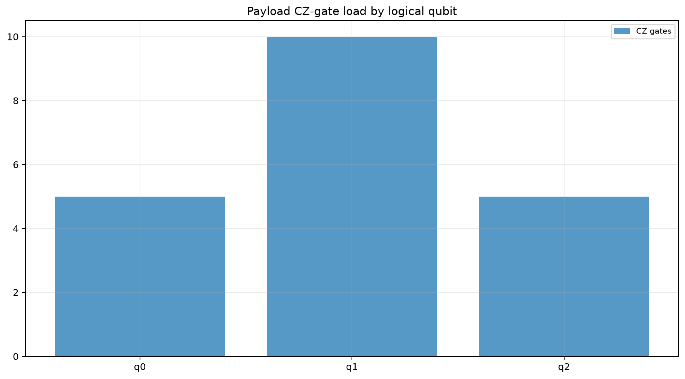
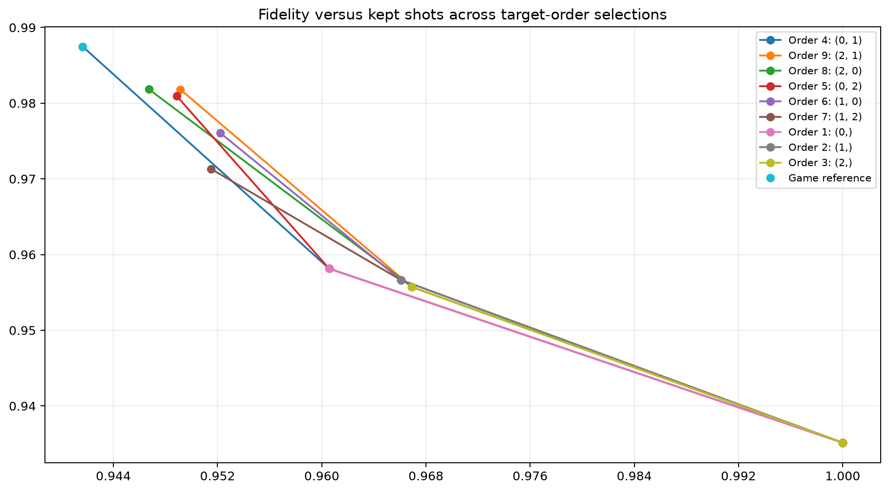
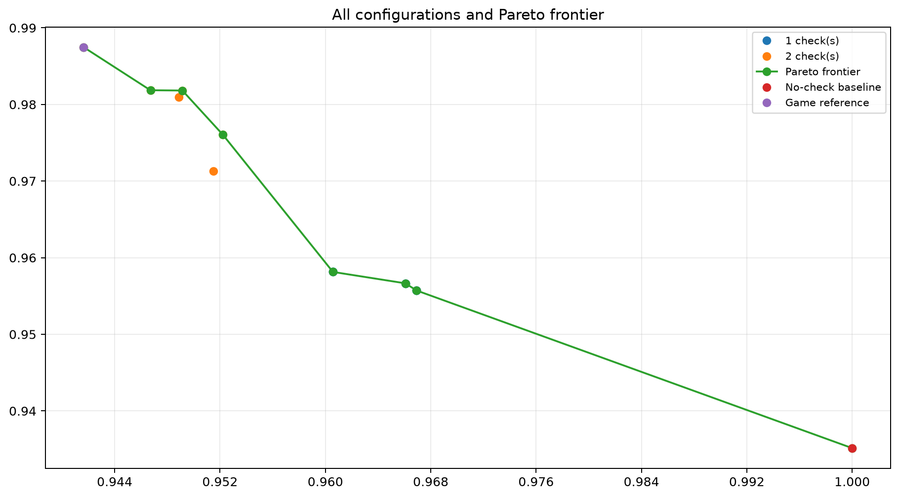
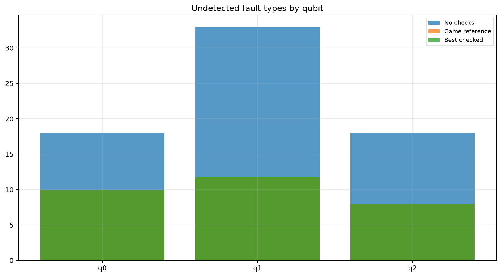
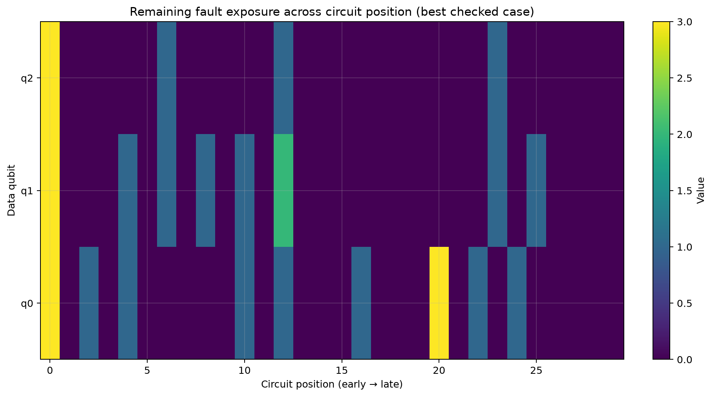
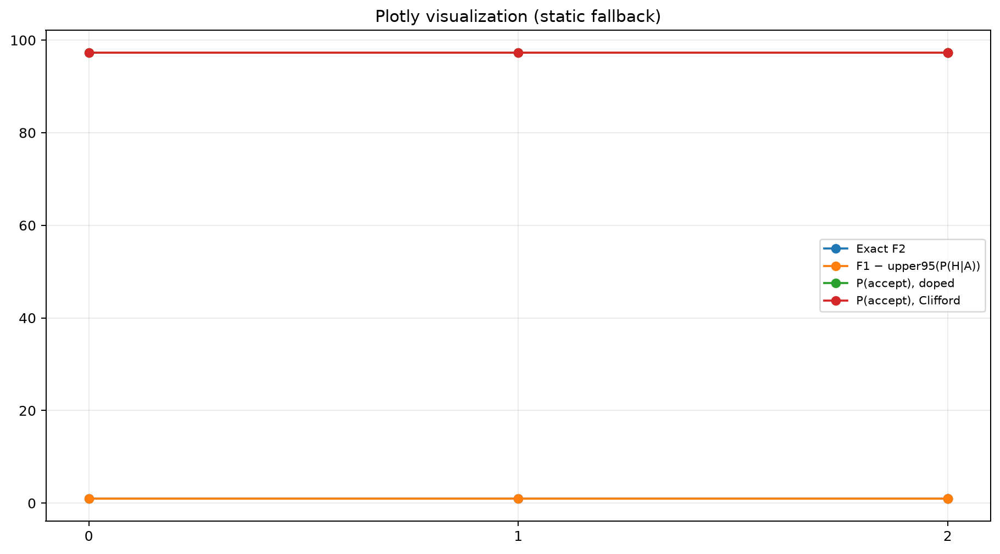
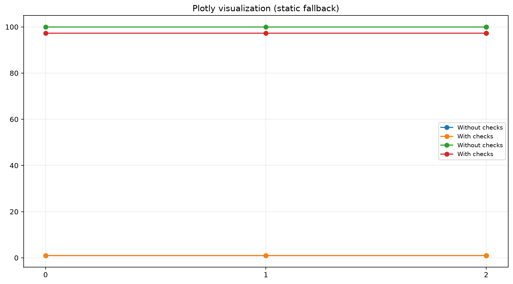
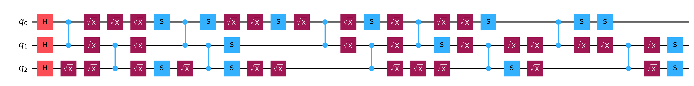
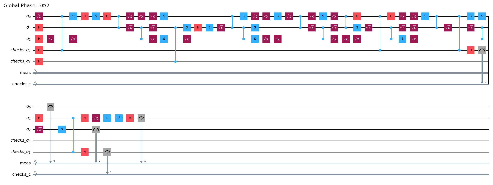

# Spacetime Sentinel — Level 1 Analysis

- **Seed:** 67
- **Level:** 1. First light
- **Logical data qubits:** 3
- **Payload depth setting:** 10
- **Backend:** fake_fez
- **Physical layout:** `[22, 23, 24]`
- **Allowed check sites:** `[0, 1, 2]`
- **Check budget:** 2

## Summary

- **Best trade-off configuration:** `(0, 1)`
- **Fidelity:** 0.9874761837868624
- **Kept shots (%):** 94.16428571428571
- **Trade-off error:** 0.04511175499541132

## Main tables

- `*_metadata.csv`: run configuration and reproducibility metadata.
- `*_reference.csv`: no-check baseline and game reference.
- `*_all_check_configurations.csv`: per-placement results.
- `*_overall_comparison.csv`: combined ranked comparison.
- `*_summary_by_check_count.csv`: aggregate by check count.
- `*_summary_by_depth.csv`: aggregate by realized checked-circuit depth.
- `*_summary_by_placement.csv`: aggregate by requested/actual placement.
- `*_best_configuration_exposure.csv`: per-qubit remaining exposure.
- `validation/t_stage_validation_seed*.csv`: A–E test summary.
- `validation/t_stage_validation_details_seed*.csv`: detailed T-count diagnostics.

## Figures and circuits

### Payload Cz Load

[Open file](figures/payload_cz_load.png)

### Fidelity Vs Kept Shots

[Open file](figures/fidelity_vs_kept_shots.png)

### Pareto Frontier

[Open file](figures/pareto_frontier.png)

### Remaining Exposure By Qubit

[Open file](figures/remaining_exposure_by_qubit.png)

### Fault Exposure Heatmap

[Open file](figures/fault_exposure_heatmap.png)

### T Doping Fidelity Bound And Acceptance

[Open file](figures/t_doping_fidelity_bound_and_acceptance.png)

### T Doping Checked Vs Unchecked

[Open file](figures/t_doping_checked_vs_unchecked.png)

### Payload Clifford Circuit

[Open file](circuits/payload_clifford_circuit.png)

### Best Checked Circuit

[Open file](circuits/best_checked_circuit.png)

## T-stage validation status

- **Passed checks:** 12/12

| Level | Targets | Test | Pass |
|---|---|---|---|
| 1. First light | [0, 1] | C-site: T site indices map to data-data CZ | True |
| 1. First light | [0, 1] | C-strip: stripped Clifford equals payload | True |
| 1. First light | [0, 1] | Syndrome supports are Z-only | True |
| 1. First light | [0, 1] | A: noiseless acceptance invariant over T counts | True |
| 1. First light | [0, 1] | B: library filter matches exact projector | True |
| 1. First light | [0, 1] | C: conservative fidelity bound holds for all T counts | True |
| 1. First light | [2, 1] | C-site: T site indices map to data-data CZ | True |
| 1. First light | [2, 1] | C-strip: stripped Clifford equals payload | True |
| 1. First light | [2, 1] | Syndrome supports are Z-only | True |
| 1. First light | [2, 1] | A: noiseless acceptance invariant over T counts | True |
| 1. First light | [2, 1] | B: library filter matches exact projector | True |
| 1. First light | [2, 1] | C: conservative fidelity bound holds for all T counts | True |

## Interpretation notes

- Fidelity must always be reported together with kept-shot fraction.
- Two-qubit gate counts and undetected fault exposure can be averages across sampled stabilizer circuits; decimal values therefore do not represent fractional physical gates or faults.
- The checked/unchecked T comparison is only meaningful if the T-site, acceptance, projector, and bound validation tests pass.
- Results are simulator-dependent. Record Python and package versions before publishing.
